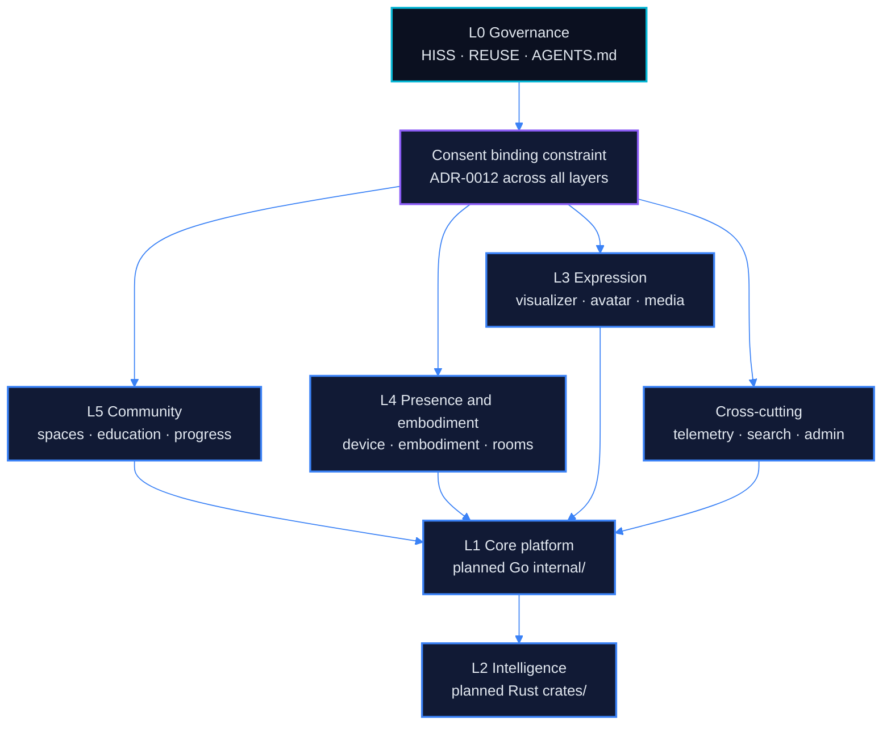

<!-- markdownlint-disable MD013 MD033 MD041 -->

<div align="center">

  

  <!-- README-STANDARD badge block: one group, fixed order -->
  <!-- 1 release/version -->
  [](docs/design-basis/OPEN-QUESTIONS.md)
  <!-- 2 CI -->
  [](https://github.com/lusoris/embodied/actions/workflows/docs.yml)
  [](https://github.com/lusoris/embodied/actions/workflows/reuse.yml)
  <!-- 3 security -->
  [](SECURITY.md)
  [](.coderabbit.yaml)
  [](.github/rulesets/main.json)
  <!-- 4 standards -->
  [](AGENTS.md)
  [](CONTRIBUTING.md)
  [](CONTRIBUTING.md)
  <!-- 5 licence -->
  [](docs/adr/0011-split-licensing-reuse.md)
  <!-- 6 support -->
  [](https://github.com/sponsors/lusoris)
  [](https://ko-fi.com/lusoris)

  **Concept for a private, international adult platform for the realistic modelling, representation, discussion and experience of human bodies, sexuality and intimacy.**

  *Concept stage: planning documents only; consent is the only hard boundary.*

</div>

emBodied is the concept for a private, international adult platform for the realistic modelling,
representation, discussion and experience of human bodies, sexuality and intimacy
([docs/MASTER_CONCEPT.md](docs/MASTER_CONCEPT.md)). **Consent is the only hard boundary**
([ADR-0012](docs/adr/0012-consent-as-only-hard-boundary.md)). The project is at the concept stage
and this repository holds planning documents only: there is no product code, no running service,
no dataset and no media, and nothing here collects or stores data about anyone.

**[Documentation site](https://lusoris.github.io/embodied/)** · [Documentation source](docs/index.md)

<a id="name"></a>The name is the English word *embodied*, pronounced the same way (em-BOD-eed); the
capital B marks the word *body* inside it. *Embody* is formed from the prefix *em-* ("in, into")
and *body*, and means to represent in a physical or concrete form
([Wiktionary](https://en.wiktionary.org/wiki/embody)).

## Adult subject matter and safety scope

- The platform described here is for adults only. The documents discuss anatomy, sexuality,
  sexual health and pornography in plain, descriptive language
  ([docs/MASTER_CONCEPT.md](docs/MASTER_CONCEPT.md)).
- Every tracked file is UTF-8 text, admitted by file type in [.gitignore](.gitignore) and checked
  by the file-type gate ([.config/embodied/file_type_gate.py](.config/embodied/file_type_gate.py),
  run by `make verify-all` in [Makefile](Makefile) and the Docs workflow in
  [.github/workflows/docs.yml](.github/workflows/docs.yml)). There are no photographs, video, audio
  or other media; the only picture is the title banner
  ([docs/assets/embodied-readme-banner.svg](docs/assets/embodied-readme-banner.svg)), an SVG text
  file that draws the project name. There is no personal data about any real person.
- The only executable files are repository tooling in [.config/embodied/](.config/embodied/): the
  file-type gate, the secret-scan replay and their tests, run by `make verify-all` and the Docs
  workflow.
- Consent is the platform's only hard boundary: every artifact carries the consent terms under
  which it may be seen, and a revoked grant reaches every copy derived from it
  ([ADR-0012](docs/adr/0012-consent-as-only-hard-boundary.md)).
- Age verification, identity checks, jurisdiction and hosting are not decided yet; see
  [OPEN-QUESTIONS.md](docs/design-basis/OPEN-QUESTIONS.md).

## Why emBodied

From [What the platform refuses to do](docs/index.md#what-the-platform-refuses-to-do) in
[docs/index.md](docs/index.md):

- **No editorial classification.** The platform does not divide material into pornographic,
  medical, educational or artistic buckets; it describes content with neutral descriptors and
  lets viewers choose ([ADR-0005](docs/adr/0005-no-editorial-classification.md)).
- **No default body.** Anatomy is a set of features, not a type with variants, so intersex, trans
  and post-surgical bodies need no special case
  ([ADR-0003](docs/adr/0003-anatomy-first-feature-model.md)).
- **No figure without uncertainty.** A number comes with its sample size and interval, and a
  percentile names its source release, cohort, protocol and uncertainty
  ([docs/concept/l1-core/statistics.md](docs/concept/l1-core/statistics.md)).
- **No racial category claims.** Population comparisons are framed by region and study cohort,
  with the regional and evolutionary mechanism stated
  ([ADR-0008](docs/adr/0008-population-comparison-as-regional-adaptation.md)).
- **No ranking of people.** There are no leaderboards, scores, streaks or engagement notifications
  ([docs/index.md](docs/index.md#what-the-platform-refuses-to-do)); progress is personal and
  non-competitive ([docs/MASTER_CONCEPT.md](docs/MASTER_CONCEPT.md)).
- **No operator exemption.** Operator access is scoped, justified, audited and bounded, and the
  audit is not written by the person doing the accessing
  ([docs/concept/cross-cutting/admin.md](docs/concept/cross-cutting/admin.md)).

## Get started

There is nothing to install or build: the repository holds planning documents only, and the
`build` target in [Makefile](Makefile) reports that no build system exists. Read the published site at
[lusoris.github.io/embodied](https://lusoris.github.io/embodied/) or follow this reading order in
the repository:

| Document | Purpose |
| :--- | :--- |
| [MASTER_CONCEPT.md](docs/MASTER_CONCEPT.md) | Canonical concept. What the platform is and what it refuses to be. |
| [docs/concept/](docs/concept/README.md) | The module architecture — one page per module. |
| [docs/adr/](docs/adr/README.md) | Architectural decision records. |
| [docs/design-basis/OPEN-QUESTIONS.md](docs/design-basis/OPEN-QUESTIONS.md) | What is not decided yet, and what would close it. |

## At a glance

The module architecture in [docs/concept/README.md](docs/concept/README.md) separates governance,
higher-level product surfaces, the core control plane and the intelligence kernel, with consent
([ADR-0012](docs/adr/0012-consent-as-only-hard-boundary.md)) binding every layer:



The planned stack — a Go control plane, a Rust compute kernel and a SvelteKit interface over
PostgreSQL, Qdrant and Memgraph — is decided in
[ADR-0001](docs/adr/0001-go-rust-svelte-split.md) and
[ADR-0002](docs/adr/0002-relational-vector-graph-persistence.md).

## Guides and reference

Role entry points from [docs/index.md](docs/index.md):

- [Users](docs/user/README.md) — what works without an account, what an account adds, the
  platform's promises and your controls.
- [Moderators](docs/moderator/README.md) — the narrow mandate, consent enforcement, queues and
  appeals.
- [Administrators](docs/admin/README.md) — what the role may see, break-glass access, operations
  and incident handling.
- [Developers](docs/dev/README.md) — planned stack, governance, coding rules and the local gate.
- [AI agents](docs/ai/README.md) — agent authority, required reading, what agents may change and
  the domain constraints they must keep.

Architecture and design basis:

- [Module architecture](docs/concept/README.md) — L0 through L5 and cross-cutting module pages.
- [ADR index](docs/adr/README.md) — architectural decision records (`ADR-0000` through `ADR-0013`).
- [Open questions](docs/design-basis/OPEN-QUESTIONS.md) — unresolved design, legal and operational
  questions.
- [Gap and deduplication pass](docs/design-basis/GAP-AND-DEDUPLICATION.md) — coverage audit against
  the recovered concept.

## Contribute

Read [CONTRIBUTING.md](CONTRIBUTING.md) and the canonical agent harness in
[AGENTS.md](AGENTS.md) before proposing changes.

- Run the local verification gate in [Makefile](Makefile) before submitting:

  ```bash
  make verify-all
  ```

- Sign every commit; the branch ruleset in
  [.github/rulesets/main.json](.github/rulesets/main.json) requires signed commits
  (`required_signatures`) and a linear history (`required_linear_history`).
- Use Conventional Commit subjects (`feat:`, `fix:`, `chore:`, or `feat!:` / `fix!:` with a
  `Migration:` footer for breaking changes) as specified in [CONTRIBUTING.md](CONTRIBUTING.md).

## Support

- **Security reports**: do not open a public issue for a vulnerability; report it privately through
  GitHub private vulnerability reporting as described in [SECURITY.md](SECURITY.md).
- **Sponsorship**: support the project through
  [GitHub Sponsors](https://github.com/sponsors/lusoris) or [Ko-fi](https://ko-fi.com/lusoris).

## Roadmap and releases

Concept stage. No implementation and no releases yet. The roadmap — phasing, jurisdiction, age
verification, payments — is deliberately not decided; see
[OPEN-QUESTIONS.md](docs/design-basis/OPEN-QUESTIONS.md).

## Upstream and licence

Split licensing, REUSE compliant
([ADR-0011](docs/adr/0011-split-licensing-reuse.md)):

- **EUPL-1.2** ([LICENSE](LICENSE)) — code, schemas, configuration and scripts
- **CC BY-SA 4.0** — documentation, prose and architectural decision records

[REUSE.toml](REUSE.toml) maps each path to its licence; the full texts are in
[LICENSES/](LICENSES/). Run `reuse lint`
([.github/workflows/reuse.yml](.github/workflows/reuse.yml)) to verify.

## Standards and governance

This repository adopts the High-Integrity Systems Standard (HISS) and modernized NASA JPL
Power-of-10 rules declared in [CONTRIBUTING.md](CONTRIBUTING.md). [AGENTS.md](AGENTS.md) lists the
invariants HISS-01 to HISS-21 with the check adopted for each and marks those without one as
advisory; `make verify-all` in [Makefile](Makefile) runs the adopted checks.

<!-- praetor:readme-governance:start -->
Praetor manages this repository's declared governance policy. This managed
block records adoption state; it is not a verification certificate.

**Verification**: `make verify-all` runs the repository's configured
verification cascade.

**HISS Audit**: `praetorctl audit` enforces policy, generated-surface
integrity, and the debt ratchet.

**Context Sync**: `praetorctl compile-context --verify` verifies every
generated agent context against `AGENTS.md`.

**Debt Baseline**: `.standards-baseline.json` anchors the debt ratchet at
0 recorded infractions; audit forbids growth.
<!-- praetor:readme-governance:end -->
